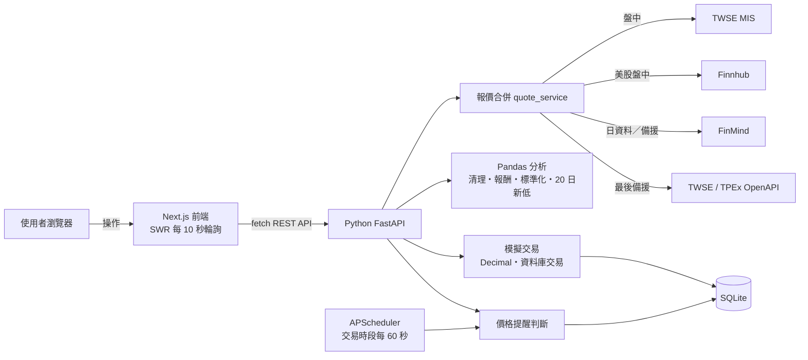

# StockVision — 台美股智慧看盤與模擬投資平台

以 **Python FastAPI** 後端與 **Next.js** 前端打造的全端 MVP：台股與美股的盤中報價、歷史走勢、模擬交易、價格提醒與多股比較。所有價格都來自真實 API，並標示資料來源、資料日期與更新時間；日資料不會被標示成即時報價。

> ⚠️ 模擬交易僅供學習：**模擬成交，不代表真實市場價格或成交**。

---

## 1. 專案介紹與主要功能

| 頁面 | 功能 |
|---|---|
| **投資總覽** Dashboard `/` | 模擬總資產、現金與損益、自選股即時表格（可勾選比較）、自選股漲跌幅長條圖、最近交易、啟用中的提醒、持股配置、比較捷徑 |
| **股票看盤** Market `/market` | 搜尋台股／美股（代號或名稱，例如 2330、台積電、AAPL）、盤中或收盤報價（開高低收、成交量、資料日期、來源）、1M／3M／6M／1Y 走勢圖與資料表、20 日新低標示、加入自選股 |
| **股票比較** Compare `/compare` | 2–4 檔股票（可台美混合）、**Python Pandas** 依共同交易日對齊並以起始日 = 100 標準化、各股收盤價小圖、累積報酬與最大回檔比較表 |
| **模擬下單** Trading `/trading` | NT$1,000,000 虛擬資金、買進／賣出、零股與「1 張」快捷、後端試算、確認對話框、資金不足與持股不足檢查；美股依臺灣銀行 USD/TWD 匯率換算 |
| **投資組合** Portfolio `/portfolio` | 持股、平均成本、市值、未實現／已實現損益、總資產、報酬率、配置圖、完整交易紀錄、重置帳戶 |
| **價格提醒** Alerts `/alerts` | ≤ 目標價、≥ 目標價、創 20 日新低；新增、編輯、停用、刪除、觸發紀錄、站內通知鈴鐺、背景排程狀態 |

即時性：

- **台股**：交易時段使用證交所 MIS 盤中報價（約 5 秒更新），前端每 10 秒自動刷新，價格變動時會閃爍；收盤後自動改用每日收盤資料。
- **美股**：設定 Finnhub 免費 API Key 後提供盤中報價；未設定時顯示 FinMind 最近交易日收盤（畫面會標示「收盤」與原因）。

## 2. 技術架構

| 層 | 技術 |
|---|---|
| 前端 | Next.js 16（App Router、Turbopack）、TypeScript、Tailwind CSS v4、shadcn/ui（Radix UI）、Recharts 3、SWR（以 fetch 輪詢） |
| 後端 | Python 3.12、FastAPI、Pydantic v2、SQLAlchemy 2、SQLite、Pandas 3、HTTPX、APScheduler |
| 測試 | Pytest + respx（後端，全部 mock 外部 API）、Vitest + Testing Library（前端單元）、Playwright + Microsoft Edge（端對端） |
| 資料來源 | FinMind API、臺灣證券交易所 OpenAPI、櫃買中心 OpenAPI、TWSE MIS 盤中報價、Finnhub（美股盤中，選用） |

```text
stockvision/
├── backend/                 # Python FastAPI
│   ├── app/
│   │   ├── main.py          # 進入點、CORS、統一錯誤格式、啟動排程
│   │   ├── api/routes/      # REST API（stocks、watchlist、trading、alerts…）
│   │   ├── core/            # 設定、錯誤、Decimal、交易時段、代號解析
│   │   ├── database/        # SQLAlchemy engine、自訂欄位型別、初始化
│   │   ├── models/          # ORM 資料表
│   │   ├── schemas/         # Pydantic 請求／回應
│   │   └── services/        # 資料來源 providers、Pandas 分析、交易、提醒、排程
│   ├── tests/               # 106 個 pytest（外部 API 全部 mock）
│   ├── requirements.txt / requirements-dev.txt
├── frontend/                # Next.js
│   ├── src/app/             # 6 個頁面
│   ├── src/components/      # UI 元件（shadcn/ui 在 components/ui）
│   ├── src/services/        # 呼叫 Python API 的 fetch 封裝
│   ├── src/hooks/ src/types/ src/lib/
│   ├── e2e/                 # Playwright 端對端測試
├── docs/                    # 架構、API、展示流程、測試報告
├── environment.yml          # conda 環境
└── .env.example             # 環境變數範本
```

詳細設計見 [docs/architecture.md](docs/architecture.md)。

## 3. 前後端資料流



前端只負責顯示與操作；**股價取得、資料清理、報酬率、模擬交易、損益與提醒判斷都在 Python 後端完成**。

## 4. 環境需求

- **Python 3.11 以上**（本專案以 conda 建立 Python 3.12 環境）
- **Node.js 20.9 以上**（開發時使用 Node.js 24）與 npm
- Git
- 執行 E2E 測試需要 Windows 內建的 **Microsoft Edge**（不需另外下載瀏覽器）
- 需要網路連線取得股票資料

## 5. 建立 Python 環境（conda）

在專案根目錄執行（Anaconda Prompt 或已執行過 `conda init` 的 PowerShell）：

```powershell
conda env create -f environment.yml
conda activate stockvision
```

`environment.yml` 會建立名為 `stockvision` 的環境並安裝 `backend/requirements-dev.txt` 的套件。

> 不使用 conda 也可以：`python -m venv .venv` 後啟用虛擬環境，再執行下一節的 pip 指令。

## 6. 安裝 Python 依賴套件

`conda env create` 已經安裝完成。若之後套件有更新：

```powershell
conda activate stockvision
pip install -r backend/requirements-dev.txt
```

- `requirements.txt`：執行所需（FastAPI、SQLAlchemy、Pandas、HTTPX、APScheduler、tzdata…）
- `requirements-dev.txt`：再加上測試工具（pytest、respx）

## 7. 安裝前端套件

```powershell
cd frontend
npm install
```

## 8. 初始化 SQLite

後端第一次啟動時會自動建立資料表與 NT$1,000,000 的模擬帳戶，也可以手動初始化：

```powershell
cd backend
python -m app.database.init_db
```

資料庫位置是 `backend/data/stockvision.db`（已列入 `.gitignore`）。想完全重新開始時，關閉後端後刪除這個檔案即可。

## 9. 環境變數

```powershell
copy .env.example .env
```

| 變數 | 說明 |
|---|---|
| `FINMIND_TOKEN` | 選填。未填時 FinMind 每小時 300 次；到 [finmindtrade.com](https://finmindtrade.com/) 註冊並驗證信箱後可提高到 600 次 |
| `FINNHUB_API_KEY` | 選填。美股盤中報價；到 [finnhub.io](https://finnhub.io/register) 免費註冊。未填時美股顯示最近交易日收盤 |
| `DATABASE_URL` | SQLite 位置，預設 `sqlite:///./data/stockvision.db`（相對於 `backend/`） |
| `CORS_ORIGINS` | 允許呼叫 API 的前端網址 |
| `ALERT_SCHEDULER_ENABLED` / `ALERT_CHECK_INTERVAL_SECONDS` | 價格提醒背景排程開關與間隔（預設開啟、60 秒） |

`.env` 不會上傳到 GitHub。前端預設呼叫 `http://localhost:8000`，需要時可在 `frontend/.env.local` 設定 `NEXT_PUBLIC_API_BASE_URL`。

## 10. 啟動

開兩個終端機：

```powershell
# 終端機 1：Python 後端
conda activate stockvision
cd backend
uvicorn app.main:app --reload --port 8000
```

```powershell
# 終端機 2：Next.js 前端
cd frontend
npm run dev
```

打開 **http://localhost:3000**。

## 11. API 文件

- Swagger UI：**http://localhost:8000/docs**
- ReDoc：http://localhost:8000/redoc
- 端點說明：[docs/api.md](docs/api.md)

所有錯誤都使用相同格式：`{"error": {"code": "INSUFFICIENT_FUNDS", "message": "可用資金不足…", "details": {...}}}`。

## 12. Git 與 GitHub

- Repository：https://github.com/Lin0821-yanting/stockvision（Private）
- 主要分支：`main`，依開發階段提交（初始化 → 股票 API → 看盤 → 模擬交易 → 提醒 → 比較 → 總覽 → 測試 → 文件）

```powershell
git clone https://github.com/Lin0821-yanting/stockvision.git
git log --oneline
```

## 13. 操作示範流程

完整的課堂展示腳本見 [docs/demo-guide.md](docs/demo-guide.md)，摘要如下：

1. 開啟 http://localhost:3000，在上方搜尋框輸入「台積電」→ 選擇 2330
2. 看盤頁顯示 TWSE MIS 報價（盤中／收盤標籤、來源與時間）與 FinMind 歷史走勢，切換 1M／1Y
3. 開啟 http://localhost:8000/docs 展示 FastAPI，執行 `GET /api/stocks/2330`
4. 按「模擬下單」→ 買進 100 股 → 確認，帳戶現金與持股立即更新
5. 到「投資組合」查看持股、市值與損益
6. 按「設定提醒」→ 建立 ≤ 目標價的提醒；目標價高於目前價格時會立刻觸發站內通知
7. 到「股票比較」加入 2330 與 2317（可再加 AAPL），說明 Pandas 以共同交易日對齊、起始日 = 100
8. 執行 `git log --oneline` 展示 Commit 歷史，最後開啟 GitHub Repository

## 14. 已完成功能與已知限制

**已完成**

- 台股（上市、上櫃）與美股搜尋、報價、歷史走勢與 20 日新低
- 盤中自動更新（台股 TWSE MIS；美股需 Finnhub Key）與收盤資料自動切換、來源與時間標示
- 模擬交易：Decimal 精確計算、加權平均成本、已實現／未實現損益、資料庫交易、重置後保留歷史
- 價格提醒：三種條件、兩種觸發模式、同步檢查 + 背景排程、站內通知
- 多股比較：Pandas 日期對齊與標準化、small multiples、比較表
- 統一錯誤處理（外部 API 失敗時顯示錯誤，不用假資料補空）、載入／空資料狀態、深色主題、手機版

**已知限制**

- TWSE MIS 是證交所網頁使用的公開端點，不屬於官方 OpenAPI 文件，格式可能變動；請求過於頻繁可能被暫時封鎖（後端已合併請求並加上 5 秒快取與節流）
- Finnhub 報價不含成交量，盤中時成交量顯示前一交易日的 FinMind 日資料並加註說明
- 沒有內建國定假日行事曆，市況燈號依星期與時間判斷；假日時報價會停在最後交易日並標示時間
- 美股匯率使用臺灣銀行每日牌告的即期中價（FinMind），不是即時匯率
- 第一版不計手續費與證交稅（資料表已保留欄位）
- 單一使用者、沒有登入
- 價格提醒只在後端運行時檢查；網站與後端都關閉時無法監控價格；沒有手機推播、LINE 或 Email
- K 線圖不在這一版範圍內

## 測試

```powershell
# 後端（全部使用 mock，不需要網路）
cd backend
python -m pytest

# 前端單元測試、型別與 lint、正式建置
cd frontend
npm run test
npm run typecheck
npm run lint
npm run build

# 端對端測試（需要網路與 Microsoft Edge；會另外啟動 :8001 與 :3001）
conda activate stockvision
npm run test:e2e
```

最近一次的實際測試結果記錄在 [docs/test-report.md](docs/test-report.md)。
