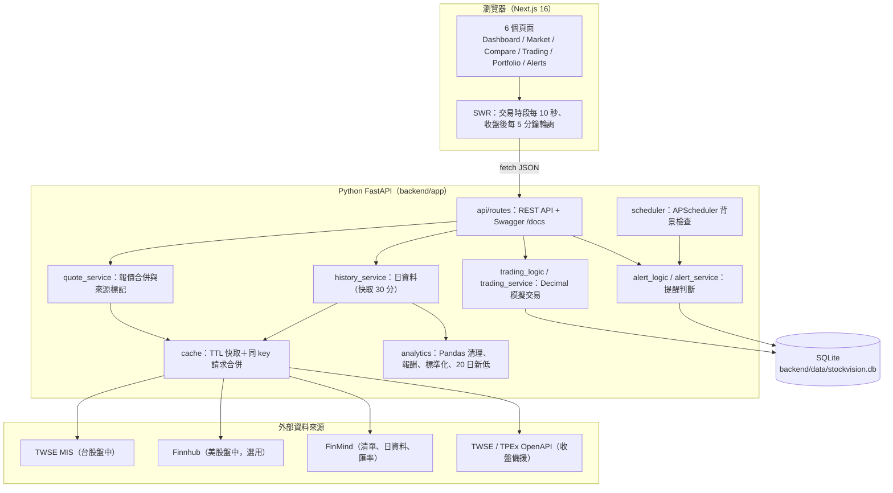

# StockVision 技術架構

## 系統總覽



設計原則：**純函式核心 + I/O 外殼**。計算邏輯（`analytics.py`、`trading_logic.py`、`alert_logic.py`）不碰網路與資料庫，可以直接單元測試；`*_service.py` 負責呼叫外部 API 與讀寫資料庫。

## 資料來源與報價合併

| 用途 | 台股 | 美股 |
|---|---|---|
| 股票清單（搜尋） | FinMind `TaiwanStockInfo`（只保留 twse / tpex） | FinMind `USStockInfo` |
| 歷史日資料 | FinMind `TaiwanStockPrice` | FinMind `USStockPrice` |
| 盤中報價 | TWSE MIS `getStockInfo.jsp`（上市 `tse_`、上櫃 `otc_`） | Finnhub `/quote`（需要 `FINNHUB_API_KEY`） |
| 收盤備援 | TWSE OpenAPI `STOCK_DAY_ALL`、TPEx OpenAPI `daily_close_quotes` | — |
| 匯率 | FinMind `TaiwanExchangeRate`（臺灣銀行即期買賣中價） | |

`quote_service` 的順序：

```text
台股：TWSE MIS ──(沒有成交價／失敗)──> FinMind 日資料 ──(失敗)──> TWSE / TPEx OpenAPI
美股：Finnhub   ──(沒有 Key／失敗)───> FinMind 日資料
```

每一筆報價都帶：

- `kind`：`realtime`（盤中）或 `close`（收盤／最近交易日）
- `source`：資料來源名稱
- `trade_date`：價格所屬交易日
- `as_of`：報價時間（交易所當地時區）
- `fetched_at`：後端實際向外部 API 取得資料的時間
- `note`：例如「今日尚無成交，顯示前一交易日收盤」

MIS 在當日尚無成交時，成交價欄位是 `-`。此時**不會**拿買賣價或其他數字冒充成交價，而是改顯示前一交易日收盤並加註說明。所有來源都失敗時回傳錯誤（HTTP 503），前端顯示錯誤提示，不會用假資料補空。

## 快取、節流與重試

| 資料 | 快取 | 說明 |
|---|---|---|
| MIS 報價 | 5 秒 | 多檔合併成一次請求；最近 2 分鐘被查過的台股會一起更新；兩次請求至少間隔 2 秒 |
| Finnhub 報價 | 15 秒 | 免費方案約 60 次／分 |
| 歷史日資料 | 30 分鐘 | 一次抓約 400 天，再在本機切出 1M／3M／6M／1Y，節省 FinMind 額度 |
| OpenAPI 全市場快照 | 10 分鐘 | 只在備援時使用 |
| 匯率 | 1 小時 | 臺灣銀行牌告為日資料 |
| 股票清單 | SQLite，24 小時 | 搜尋只查本機資料表，打字時不會一直呼叫外部 API；更新失敗時沿用舊清單 |

HTTP 層（`providers/http.py`）在逾時、連線失敗、429、5xx 時最多重試 2 次（指數退避），最後轉成統一的 `UpstreamError`。FinMind 回傳 `status 402`（超過額度）時轉成 `UPSTREAM_RATE_LIMITED`。API token 一律放在 HTTP header（FinMind 用 `Authorization: Bearer`，Finnhub 用 `X-Finnhub-Token`），不會出現在網址或 log。

## Pandas 分析

- **清理**（`clean_history`）：統一欄位名稱、轉型、移除日期無效或收盤 ≤ 0 的列、依日期穩定排序並去除重複日期，計算單日 `change` 與 `change_pct`
- **期間切片**（`slice_period`）：保留期初前最後一個交易日作為報酬率基準
- **區間統計**（`summarize`）：期初／期末收盤、累積報酬率、最高、最低、平均成交量
- **20 日新低**（`recent_low`）：最新價格 < 前 20 個交易日（不含報價當日）的最低收盤價
- **標準化比較**（`normalize_prices`）：
  1. 以所有股票最晚的交易日為期末，往前取期間
  2. 用 `pd.concat(..., join="inner")` **只保留每一檔都有交易的日期**（台股與美股假日不同，不同日期的股價不會互相比較）
  3. 共同起始日收盤 = 100：`指數 = 當日收盤 ÷ 共同起始日收盤 × 100`
  4. 另外計算累積報酬、最大回檔，以及各股被排除的日數

## 模擬交易

- 成交價一律由後端取得（盤中價或最近收盤價），**不接受前端傳入的價格**；成交紀錄保存價格種類、來源與時間
- 金額使用 `Decimal`：API 的浮點數先轉字串再轉 `Decimal`。SQLite 沒有十進位型別，因此用自訂的 `DecimalText` 欄位以文字儲存，避免浮點誤差
- 買進：台幣金額 = 股數 × 價格 × 匯率（台股匯率為 1），四捨五入到 0.01；可用現金不足時回傳 `INSUFFICIENT_FUNDS`
- 平均成本採加權平均；持倉同時記錄原幣平均成本與台幣總成本，因此美股的未實現損益包含匯率變動
- 賣出：不可超過持股（`INSUFFICIENT_SHARES`）；已實現損益 = 賣出金額 − 依比例分攤的台幣成本；全部賣出時一次扣完剩餘成本，避免四捨五入零頭
- 現金、持股、交易紀錄在**同一個資料庫交易**內寫入，任何一步失敗就整筆 rollback。取得價格之後才讀帳戶，計算與寫入之間沒有 `await`，不會被其他請求插隊
- 重置帳戶：清空持股、現金回到初始值、`cycle + 1`；舊交易保留，可以切換「全部」查看
- 手續費與證交稅欄位保留為 0（`fees_and_taxes` 是擴充點）

## 價格提醒

- 條件：`PRICE_LTE`（≤）、`PRICE_GTE`（≥）、`NEW_20D_LOW`（創 20 日新低）
- **邊緣觸發**：只有「不成立 → 成立」才觸發，條件持續成立時不會每次輪詢都重複通知
- 模式：`ONCE` 觸發後自動停用；`EVERY_CROSS` 條件恢復後再次成立會再通知
- 修改條件或重新啟用時重新開始判斷，條件已成立會立即通知
- 檢查時機：
  1. 前端取得行情時同步檢查（個股、批次報價、自選股、比較）
  2. 建立或修改提醒時立即檢查一次
  3. 手動「立即檢查」
  4. APScheduler 背景排程：只在台股或美股開盤時才抓報價，`max_instances=1`、`coalesce=True`
- 觸發紀錄（`alert_events`）同時是站內通知；刪除提醒後紀錄保留（`alert_id` 設為 NULL）
- 限制：只有後端運行時才會檢查；網站與後端都關閉時無法監控價格

## 資料表

| 資料表 | 內容 |
|---|---|
| `stock_catalog` | 股票清單快取（market、symbol、name、exchange、industry） |
| `watchlist_items` | 自選股 |
| `accounts` | 模擬帳戶（初始資金、現金、cycle） |
| `positions` | 目前持股（股數、原幣平均成本、台幣成本） |
| `trades` | 每筆模擬成交（價格、匯率、金額、已實現損益、價格來源與時間、cycle） |
| `alerts` | 提醒條件與最近一次檢查狀態 |
| `alert_events` | 觸發紀錄與通知已讀狀態 |

## 前端

- **資料取得**：`src/services/*` 以 fetch 封裝 REST API，錯誤統一轉成 `ApiError`；`src/hooks/*` 以 SWR 管理快取與輪詢。輪詢頻率依 `/api/market/status` 決定：盤中 10 秒、收盤後 5 分鐘
- **狀態**：每個區塊都有載入骨架、錯誤狀態（顯示後端訊息與錯誤代碼、可重試）與空資料狀態；重新整理時保留舊資料並降低透明度，不閃爍骨架
- **配色**：深色 FinTech 主題、藍色強調色；台股慣例**上漲紅、下跌綠**，並一律搭配 ▲▼ 與正負號，不只靠顏色
- **圖表**（Recharts）：類別色依固定順序使用，並用 dataviz 驗證工具對深色卡片 `#111114` 驗證（明度、彩度、色盲區分、對比）。顏色跟著股票走，不依排名換色。不使用雙 Y 軸：價格與成交量分成兩張共用十字線的圖，多股價格用 small multiples；每張圖都有 tooltip 與表格版本
