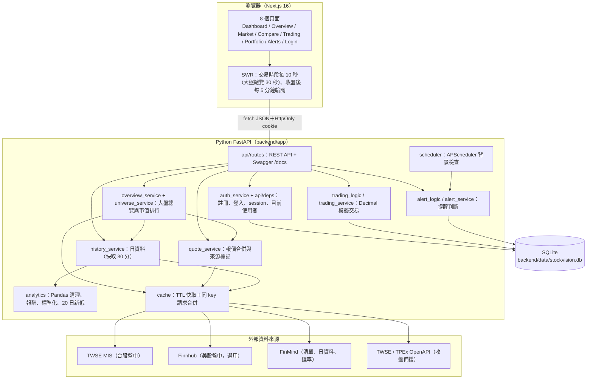

# StockVision 技術架構

## 系統總覽



設計原則：**純函式核心 + I/O 外殼**。計算邏輯（`analytics.py`、`trading_logic.py`、`alert_logic.py`）不碰網路與資料庫，可以直接單元測試；`*_service.py` 負責呼叫外部 API 與讀寫資料庫。

## 資料來源與報價合併

| 用途 | 台股 | 美股 |
|---|---|---|
| 股票清單（搜尋） | FinMind `TaiwanStockInfo`（只保留 twse / tpex） | FinMind `USStockInfo` |
| 歷史日資料 | FinMind `TaiwanStockPrice` | FinMind `USStockPrice` |
| 盤中報價 | TWSE MIS `getStockInfo.jsp`（上市 `tse_`、上櫃 `otc_`） | Finnhub `/quote`（需要 `FINNHUB_API_KEY`） |
| 收盤備援 | TWSE OpenAPI `STOCK_DAY_ALL`、TPEx OpenAPI `daily_close_quotes` | — |
| 匯率 | FinMind `TaiwanExchangeRate`（臺灣銀行即期買賣中價） | |
| 市值排行（大盤總覽） | TWSE OpenAPI `t187ap03_L` 已發行普通股數 × `STOCK_DAY_ALL` 收盤價 | FinMind `USStockInfo` 的 `MarketCap` |
| 指數（大盤總覽） | 加權指數：盤中 MIS `tse_t00.tw`、日資料 FinMind `TaiwanStockPrice`（`TAIEX`） | `^GSPC`、`^IXIC`、`^DJI`：FinMind `USStockPrice`（只有每日收盤） |

`quote_service` 的順序：

```text
台股：TWSE MIS ──(沒有成交價／失敗)──> FinMind 日資料 ──(失敗)──> TWSE / TPEx OpenAPI
美股：Finnhub   ──(沒有 Key／失敗)───> FinMind 日資料
```

每一筆報價都帶：

- `kind`：`realtime`（盤中）或 `close`（收盤／最近交易日）
- `source`：資料來源名稱
- `trade_date`：價格所屬交易日
- `as_of`：報價時間（交易所當地時區）
- `fetched_at`：後端實際向外部 API 取得資料的時間
- `note`：例如「今日尚無成交，顯示前一交易日收盤」

MIS 在當日尚無成交時，成交價欄位是 `-`。此時**不會**拿買賣價或其他數字冒充成交價，而是改顯示前一交易日收盤並加註說明。所有來源都失敗時回傳錯誤（HTTP 503），前端顯示錯誤提示，不會用假資料補空。

## 快取、節流與重試

| 資料 | 快取 | 說明 |
|---|---|---|
| MIS 報價 | 5 秒 | 多檔合併成一次請求；最近 2 分鐘被查過的台股會一起更新；兩次請求至少間隔 2 秒 |
| Finnhub 報價 | 15 秒 | 免費方案約 60 次／分 |
| 歷史日資料 | 30 分鐘 | 一次抓約 400 天，再在本機切出 1M／3M／6M／1Y，節省 FinMind 額度 |
| OpenAPI 全市場快照 | 10 分鐘 | 只在備援時使用 |
| 匯率 | 1 小時 | 臺灣銀行牌告為日資料 |
| 股票清單 | SQLite，24 小時 | 搜尋只查本機資料表，打字時不會一直呼叫外部 API；更新失敗時沿用舊清單 |
| 市值排行 | 12 小時 | 只決定大盤總覽要列哪幾家公司；報價與走勢另外即時取得 |
| 大盤總覽回應 | 30 秒 | 多個分頁同時輪詢時只向外部 API 取一次 |

HTTP 層（`providers/http.py`）在逾時、連線失敗、429、5xx 時最多重試 2 次（指數退避），最後轉成統一的 `UpstreamError`。FinMind 回傳 `status 402`（超過額度）時轉成 `UPSTREAM_RATE_LIMITED`。API token 一律放在 HTTP header（FinMind 用 `Authorization: Bearer`，Finnhub 用 `X-Finnhub-Token`），不會出現在網址或 log。

## Pandas 分析

- **清理**（`clean_history`）：統一欄位名稱、轉型、移除日期無效或收盤 ≤ 0 的列、依日期穩定排序並去除重複日期，計算單日 `change` 與 `change_pct`
- **期間切片**（`slice_period`）：保留期初前最後一個交易日作為報酬率基準
- **區間統計**（`summarize`）：期初／期末收盤、累積報酬率、最高、最低、平均成交量
- **20 日新低**（`recent_low`）：最新價格 < 前 20 個交易日（不含報價當日）的最低收盤價
- **標準化比較**（`normalize_prices`）：
  1. 以所有股票最晚的交易日為期末，往前取期間
  2. 用 `pd.concat(..., join="inner")` **只保留每一檔都有交易的日期**（台股與美股假日不同，不同日期的股價不會互相比較）
  3. 共同起始日收盤 = 100：`指數 = 當日收盤 ÷ 共同起始日收盤 × 100`
  4. 另外計算累積報酬、最大回檔，以及各股被排除的日數

## 模擬交易

- 成交價一律由後端取得（盤中價或最近收盤價），**不接受前端傳入的價格**；成交紀錄保存價格種類、來源與時間
- 金額使用 `Decimal`：API 的浮點數先轉字串再轉 `Decimal`。SQLite 沒有十進位型別，因此用自訂的 `DecimalText` 欄位以文字儲存，避免浮點誤差
- 買進：台幣金額 = 股數 × 價格 × 匯率（台股匯率為 1），四捨五入到 0.01；可用現金不足時回傳 `INSUFFICIENT_FUNDS`
- 平均成本採加權平均；持倉同時記錄原幣平均成本與台幣總成本，因此美股的未實現損益包含匯率變動
- 賣出：不可超過持股（`INSUFFICIENT_SHARES`）；已實現損益 = 賣出金額 − 依比例分攤的台幣成本；全部賣出時一次扣完剩餘成本，避免四捨五入零頭
- 現金、持股、交易紀錄在**同一個資料庫交易**內寫入，任何一步失敗就整筆 rollback。取得價格之後才讀帳戶，計算與寫入之間沒有 `await`，不會被其他請求插隊
- 重置帳戶：清空持股、現金回到初始值、`cycle + 1`；舊交易保留，可以切換「全部」查看
- 手續費與證交稅欄位保留為 0（`fees_and_taxes` 是擴充點）

## 價格提醒

- 條件：`PRICE_LTE`（≤）、`PRICE_GTE`（≥）、`NEW_20D_LOW`（創 20 日新低）
- **邊緣觸發**：只有「不成立 → 成立」才觸發，條件持續成立時不會每次輪詢都重複通知
- 模式：`ONCE` 觸發後自動停用；`EVERY_CROSS` 條件恢復後再次成立會再通知
- 修改條件或重新啟用時重新開始判斷，條件已成立會立即通知
- 檢查時機：
  1. 前端取得行情時同步檢查（個股、批次報價、自選股、比較）
  2. 建立或修改提醒時立即檢查一次
  3. 手動「立即檢查」
  4. APScheduler 背景排程：只在台股或美股開盤時才抓報價，`max_instances=1`、`coalesce=True`
- 觸發紀錄（`alert_events`）同時是站內通知；刪除提醒後紀錄保留（`alert_id` 設為 NULL）
- 多使用者：行情 API 與背景排程會檢查**所有人**的提醒（伺服器端持續監控），每筆觸發紀錄記下提醒擁有者；回應裡的 `triggered_alerts` 只放目前使用者自己的事件。手動「立即檢查」只檢查自己的提醒
- 限制：只有後端運行時才會檢查；網站與後端都關閉時無法監控價格

## 登入與資料隔離

不需要額外套件，全部使用 Python 標準函式庫（`core/security.py`、`services/auth_service.py`、`api/deps.py`）。

- **密碼**：`hashlib.scrypt`（N=2¹⁵、r=8、p=3，記憶體上限 64 MiB），每個帳號 16 bytes 隨機 salt，存成 `scrypt$N$r$p$salt$key`。參數跟著雜湊保存，日後調高成本也能驗證舊密碼；比對使用 `hmac.compare_digest`
- **Session**：登入成功產生 `secrets.token_urlsafe(32)`，放在 HttpOnly、SameSite=Lax 的 cookie `sv_session`（預設 7 天，`SESSION_DAYS`）。資料庫 `user_sessions` 只存 token 的 SHA-256，資料庫外流也不能直接拿來登入；登出時刪除該筆，立即失效。最後使用時間最多每 5 分鐘更新一次
- **API 工具**：也接受 `Authorization: Bearer <token>`；Swagger 執行 `POST /api/auth/login` 後，瀏覽器會自動帶著 cookie
- **防暴力破解**：同一個帳號＋IP 連續失敗 5 次，鎖定 60 秒（429 `TOO_MANY_ATTEMPTS`）。帳號不存在時一樣會做一次雜湊計算，錯誤訊息一律是「帳號或密碼錯誤」，不透露帳號是否存在。計數存在記憶體
- **帳號**：3–30 個英文字母、數字或底線，不分大小寫（存成小寫）；密碼 8–128 個字元
- **目前使用者**：`get_current_user`（需要登入，否則 401 `AUTH_REQUIRED`）、`get_optional_user`（行情 API：不登入也能用，登入時才回傳自己的通知）
- **資料歸屬**：`accounts`（每人一個，唯一索引）、`watchlist_items`（唯一鍵改成 user_id＋market＋symbol）、`alerts`、`alert_events` 都有 `user_id`；`positions` 與 `trades` 透過帳戶歸屬。所有查詢都加上使用者條件，讀取或修改別人的提醒一律回 404，不透露資料是否存在
- **CORS**：`allow_credentials=True`，只允許 `CORS_ORIGINS` 列出的網址。localhost:3000 與 localhost:8000 屬於同一個 site，SameSite=Lax 的 cookie 會隨前端的 fetch（`credentials: "include"`）送出
- **前端**：
  - `/api/auth/session` 未登入也回 200，瀏覽器主控台不會每一頁都出現 401
  - 個人資料的 SWR hook 在未登入時 key 為 `null`，不會送出請求；`RequireAuth` 包住模擬下單、投資組合、價格提醒，未登入時顯示登入提示，並以 `?next=` 記住原本的頁面（只接受站內路徑）
  - 登入、登出或在其他分頁換了帳號時，先清掉個人資料快取，再重新掛載畫面（`SessionBoundary`），不會短暫看到上一位使用者的資料
  - 任何個人資料請求回 401（例如 session 過期）時，重新確認登入狀態，畫面改成登入提示

## 資料庫遷移

`app/database/migrations.py` 在 `init_db` 時執行，可以重複執行：

1. 偵測到第一版的單人結構（`accounts` 沒有 `user_id`）時，先用 SQLite backup API 備份成 `stockvision.backup-YYYYmmdd-HHMMSS.db`（包含 WAL 中尚未寫回主檔的資料）
2. 建立 `users`、`user_sessions`
3. 以 SQLAlchemy inspector 檢查欄位，缺少才 `ALTER TABLE ADD COLUMN`，再建立索引
4. SQLite 不能修改唯一限制，所以自選股表用「改名 → 建立新表 → 複製資料 → 刪除舊表」重建
5. `stock_catalog` 補上 `market_cap`（清單是可以重新下載的快取，不需要備份）

舊資料的 `user_id` 是 NULL，第一位註冊者註冊時接收（`claim_legacy_data`）；之後的帳號從新的 NT$1,000,000 帳戶開始。

## 大盤總覽

`GET /api/market/overview?market=TW|US&period=1M&limit=12`（不用登入）

- **市值排行**（`universe_service`，快取 12 小時）
  - 台股：`t187ap03_L` 的「已發行普通股數」× `STOCK_DAY_ALL` 收盤價，只含上市公司；排除 91 開頭的 TDR（原股股數 × TDR 價格不是公司市值）
  - 美股：`stock_catalog.market_cap`（下載清單時一併保存 `USStockInfo` 的 `MarketCap`）。排除資料日期比整份清單最新日期早超過 7 天的列（實測有已下市股票停在 2024 年、市值異常偏大）；排除特別股、權證、債券；同一家公司的不同股票類別（例如 GOOGL／GOOG）依公司名稱合併，只保留市值最大的一檔；代號含「/」的股票（例如 BRK/B）不在可查詢的清單中
  - 加入大盤總覽之前下載的舊清單沒有市值，會強制重新下載一次（12 小時內不重複）
- **指數**：台股加權指數盤中使用 MIS `tse_t00.tw`，和 12 檔個股合併成一次 MIS 請求；美股 S&P 500、NASDAQ、道瓊只有 FinMind 每日收盤，Finnhub 免費方案不含指數，因此不會去查
- **走勢**：沿用 `history_service` 的日資料快取，以 `asyncio.Semaphore(4)` 限制同時向 FinMind 發出的請求數；先取日資料再取報價，報價的收盤備援直接使用快取
- **失敗隔離**：單一股票的報價或走勢失敗只標示在那張卡片（`quote_error`、`history_error`）；排行失敗時仍然顯示指數，原因放在 `warnings`
- 整份結果快取 30 秒；取得行情時同步檢查價格提醒
- **前端**（`components/overview/`）
  - 兩頁並排，以 `translateX` 切換（300ms；使用者設定減少動態時取消動畫）
  - pointer events 判斷拖曳：橫向超過 60px 才換頁、`touch-action: pan-y` 保留上下捲動，拖曳結束時不會誤點卡片連結（判斷邏輯在 `lib/swipe.ts`）
  - 切換鈕（tablist）、方向鍵與下方圓點都能切換；沒有顯示的那一頁設為 `inert`
  - 第一次切到某個市場才載入；該市場開盤時每 30 秒更新，收盤後每 5 分鐘
  - 每張小走勢圖都是單一序列（series-1 藍色）、各自的價格刻度，滑過時顯示日期與收盤價；漲跌以文字顏色＋▲▼＋正負號表示；「表格」是同一份資料的表格版本

## 資料表

| 資料表 | 內容 |
|---|---|
| `users` | 帳號（小寫）、顯示名稱、密碼雜湊、建立與最後登入時間 |
| `user_sessions` | 登入 session（token 的 SHA-256、到期時間、最後使用時間、User-Agent） |
| `stock_catalog` | 股票清單快取（market、symbol、name、exchange、industry、美股 market_cap） |
| `watchlist_items` | 自選股（user_id） |
| `accounts` | 模擬帳戶（user_id、初始資金、現金、cycle） |
| `positions` | 目前持股（股數、原幣平均成本、台幣成本） |
| `trades` | 每筆模擬成交（價格、匯率、金額、已實現損益、價格來源與時間、cycle） |
| `alerts` | 提醒條件與最近一次檢查狀態（user_id） |
| `alert_events` | 觸發紀錄與通知已讀狀態（user_id） |

## 前端

- **資料取得**：`src/services/*` 以 fetch（`credentials: "include"`）封裝 REST API，錯誤統一轉成 `ApiError`；`src/hooks/*` 以 SWR 管理快取與輪詢。輪詢頻率依 `/api/market/status` 決定：盤中 10 秒、收盤後 5 分鐘（大盤總覽盤中 30 秒）
- **登入**：`use-auth` 讀取 `/api/auth/session`；個人資料 hook 未登入時不送請求；頂欄顯示使用者選單與通知鈴鐺（只在登入後出現），側欄在需要登入的頁面旁標示鎖頭
- **狀態**：每個區塊都有載入骨架、錯誤狀態（顯示後端訊息與錯誤代碼、可重試）與空資料狀態；重新整理時保留舊資料並降低透明度，不閃爍骨架
- **配色**：深色 FinTech 主題、藍色強調色；台股慣例**上漲紅、下跌綠**，並一律搭配 ▲▼ 與正負號，不只靠顏色
- **圖表**（Recharts）：類別色依固定順序使用，並用 dataviz 驗證工具對深色卡片 `#111114` 驗證（明度、彩度、色盲區分、對比）。顏色跟著股票走，不依排名換色。不使用雙 Y 軸：價格與成交量分成兩張共用十字線的圖，多股價格用 small multiples；每張圖都有 tooltip 與表格版本
